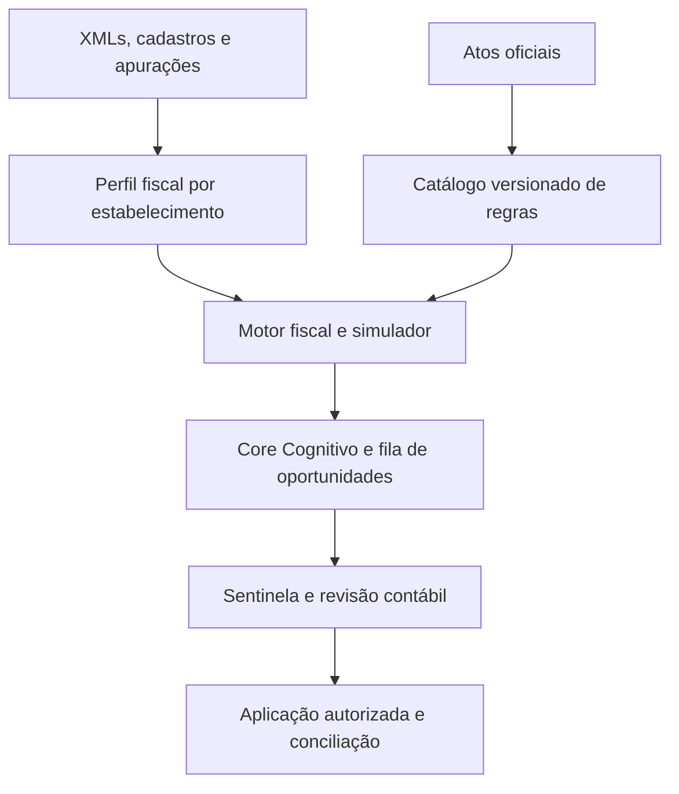

# NFCore — Central de Economia Fiscal

Este documento define a arquitetura proposta e as regras de execução para agentes que construírem o módulo no NFCore. A unidade de entrega é um bloco funcional completo, com valor próprio e promoção individual para produção.

## Arquitetura

| Módulo | Responsabilidade e contrato |
| --- | --- |
| Perfil fiscal | Consolida atividade efetiva, regime, UF, município, operações, receitas, folha e apurações disponíveis. Emite snapshot imutável por tenant, estabelecimento e competência, com origem e indicador de completude de cada dado. |
| Catálogo | Armazena versões imutáveis de regras com tributo, dispositivo e fonte oficial, vigência, jurisdição, requisitos, exceções, incompatibilidades e evidências. Fluxo de publicação com revisão fiscal. Revogação impede novos usos e abre revisão dos casos afetados. |
| Motor fiscal | Reutiliza os componentes canônicos do NFCore. Recebe snapshot e versão publicada da regra e retorna elegibilidade, motivos, evidências, memória de cálculo e impacto por tributo e período. Usa decimal e arredondamento conforme a regra. Ausência de cobertura ou de dados obrigatórios gera pendência explícita. |
| Core Cognitivo | Localiza regras candidatas, explica resultados, solicita dados e propõe atualizações para revisão. Atua com acesso segregado por tenant. As fontes externas são tratadas como dados. Elegibilidade, valores, publicação de regras e comandos de aplicação pertencem aos fluxos controlados. |
| Sentinela | Verifica evidência, competência, jurisdição, elegibilidade e validade da versão. Vincula o parecer e a aprovação ao snapshot e ao resultado exatos. Mudança material exige reavaliação antes da execução. |
| Central fiscal | Mostra cobertura, lacunas, oportunidades, base legal, prazos e cenários. O contador pode revisar, aprovar ou rejeitar e exportar o dossiê. Exibe economia potencial, aprovada e realizada separadamente. |
| Aplicação e conciliação | Executa somente comandos suportados e autorizados, registra evidências e concilia com a apuração ou confirmação oficial. Preserva histórico de ajustes, estornos e divergências. |

### Invariantes

- Isolar tenant e estabelecimento na API, nos jobs, nas consultas, no armazenamento e nas exportações. Aplicar RBAC por papel, proteger dados fiscais e restringir o conteúdo de logs e contextos enviados ao modelo.
- Identificar cada execução por escopo, competência, operação, versão de regra e snapshot. Reprocessar com idempotência. Impedir concorrência de comandos equivalentes e dupla contagem do mesmo efeito fiscal.
- Separar carga vigente, cenário proposto, economia bruta, custos e economia líquida. Usar a mesma base de comparação e explicitar dados ausentes e premissas. Registrar impacto financeiro realizado somente após conciliação documentada.
- Separar comparação de regimes, tratamento da operação e incentivo sujeito a habilitação. A atividade efetiva e os requisitos documentados governam a análise. Alterações cadastrais e fiscais passam por autorização contábil vinculada ao escopo.
- Para cada regra, distinguir competência do fato gerador e data de publicação da versão. Preservar reprodutibilidade histórica e tratar transição CBS/IBS por período e tributo. Selecionar a norma oficial vigente na construção de cada pacote.

## Controles obrigatórios desde o Bloco 1

### Desempenho e orçamento da IA

- Processar XMLs e agregar indicadores localmente por competência, atividade e operação. Enviar ao Core apenas resumos, exceções e referências às evidências. Consultar detalhes sob demanda, com autorização e minimização de dados.
- Reutilizar resultados com cache segregado por tenant e estabelecimento. Incluir na chave competência, ID do snapshot e versões exatas das regras. Para explicações, incluir também a versão do modelo e do prompt. Revalidar permissões no acesso ao cache e usar a chave atualizada quando os insumos mudarem.
- Definir orçamento por execução e por tenant, com limites de tokens, concorrência e tentativas. Medir latência, tokens, custo e acertos de cache. Se o modelo falhar ou atingir o limite, preservar o resultado determinístico e sinalizar a explicação como pendente.
- **Aceite:** executar carga representativa, incluindo cenário de 100 mil itens quando compatível com o volume esperado. Registrar limites antes do teste e comprovar o comportamento com cache frio e quente, troca de versão, isolamento entre tenants e indisponibilidade da IA.

### Versionamento e rastreabilidade fiscal

- Atribuir ID imutável e hash do conteúdo canônico a cada versão publicada. Vincular cada cálculo ao snapshot, às versões exatas das regras e à versão do motor. Preservar as referências e permitir busca inversa dos cálculos afetados por uma regra.
- Registrar revogações com data de efeito. Bloquear o uso em competências fora da vigência e preservar a reprodução da apuração histórica. Quando uma correção tiver efeito retroativo, gerar nova avaliação vinculada à original e registrar fundamento, diferenças e parecer.
- **Aceite:** reproduzir um cálculo histórico após nova publicação, bloquear regra fora da vigência, localizar todos os casos afetados em um conjunto de referência e preservar ambas as avaliações após uma correção retroativa.

### Autoridade e permissões

- O Core sugere e explica. O motor fiscal calcula. O Sentinela valida. A aplicação exige autorização contábil vinculada ao resultado e ao escopo exatos.
- Restringir a identidade do Core a leitura autorizada e ao envio de sugestões por contrato próprio. Impedir escrita fiscal direta, publicação de regras, aprovação de pareceres e execução de comandos fiscais por API, fila ou banco de dados.
- **Aceite:** testar tentativas de escrita e escalada de privilégios com a identidade do Core. Comprovar recusa, registro em auditoria e ausência de mutação fiscal. Testar o bloqueio de aplicação quando a aprovação estiver ausente, vencida ou vinculada a outra versão.

## Blocos funcionais

| Bloco | Entrega disponível ao concluir | Condição específica de aceite |
| --- | --- | --- |
| **1. Diagnóstico do Simples e Fator R** | Perfil fiscal inicial, catálogo mínimo, importação ou coleta de folha e receita, cálculo, fila de oportunidades e parecer exportável. Escopo inicial de diagnóstico. | Casos abaixo, no limite e acima do patamar, início de atividade, atividade fora do escopo e dados incompletos. Conferência com exemplos oficiais e apuração de referência. |
| **2. Segregação de receitas** | Análise de operações cobertas, fila por documento ou item, comparação com a apuração e dossiê de divergências. | Conferir classificações, devoluções, duplicidade de XML e exclusões por tributo. Identificar classificação ou tratamento inconclusivo e validar totalização por competência. |
| **3. Incentivos por jurisdição** | Catálogo de benefícios com cobertura explícita por tributo, UF, município e setor. Primeiro pacote geográfico escolhido com a contabilidade conforme os estabelecimentos atendidos. Dossiê de habilitação e calendário. | Validar requisitos, contrapartidas, vigência, acumulação, exclusões e mudanças na transição tributária. Ampliar por pacote certificado. |
| **4. Comparador de regimes** | Simulações de Simples, Presumido e Real quando elegíveis, com carga total, créditos, custos, caixa, sensibilidade e prazo de decisão. | Reconciliar com cálculos contábeis de referência. Bloquear conclusão para regime inelegível, cobertura insuficiente ou ausência de dados materiais. |
| **5. Aplicação prospectiva** | Aprovação formal, alteração controlada dos parâmetros suportados, prévia de impacto no motor fiscal e conciliação da primeira apuração. | Testar mudança de regra entre aprovação e execução, operação repetida, falha parcial, rollback e preservação de documentos históricos. |
| **6. Revisão histórica e recuperação** | Triagem por competência, dossiê auditável e fluxo de acompanhamento de retificação, restituição ou compensação nas modalidades cobertas. | Validar prazos e efeitos encadeados, prevenir pedidos duplicados e exigir evidência oficial para marcar o valor como realizado. Cada modalidade entra em produção somente com a jornada completa do escopo anunciado. |

Os blocos 2 a 4 ampliam o diagnóstico. O bloco 5 depende da certificação das regras que aplicará. O bloco 6 reutiliza aprovação e conciliação com controles próprios para períodos anteriores. Cada bloco entrega interface, API, dados, permissões, auditoria e operação para suas funções. Infraestrutura compartilhada entra junto da primeira função que a utiliza.

## Regra de produção

**A implantação ocorre bloco a bloco, somente com 100% das funções do escopo aprovado construídas e certificadas internamente.** Escopo e cobertura são registrados antes da implementação. Redução posterior de escopo exige decisão explícita e atualização dos critérios. Telas parciais, stubs, integrações simuladas em produção e flags ocultando funções inacabadas bloqueiam a promoção do bloco.

1. **Antes de construir:** inspecionar o repositório e suas instruções. Mapear o motor fiscal, o Sentinela, o Core, a autenticação, as migrations e a esteira de implantação. Registrar entradas, saídas, regras cobertas, casos de aceite e dependências externas.
2. **Certificar internamente:** executar testes fiscais de referência, integração, ponta a ponta na interface, isolamento entre empresas, RBAC, regressão de emissão, migrations e recuperação de falhas. Conferir a base legal e a memória de cálculo com revisão fiscal. Guardar versão, commit, casos e resultados. Desde o Bloco 1, incluir evidências dos controles de orçamento da IA, rastreabilidade fiscal e autoridade descritos neste documento.
3. **Separar prontidão de ativação:** credenciais do cliente, certificado, autorização ou habilitação oficial são condições externas. O bloco só pode ser publicado se o fluxo interno estiver completo e essas dependências forem detectadas e comunicadas. A ação que depende de homologação externa fica bloqueada até haver evidência correspondente. Falta de adapter ou de uma etapa interna bloqueia o bloco.
4. **Promover e verificar:** usar a esteira autorizada, com migrations compatíveis, plano de rollback e responsável identificado. Rodar smoke de produção, verificar a emissão existente e monitorar erros, fila, regras vencidas, pendências e divergências. Interromper a promoção do bloco seguinte até fechar a verificação do atual.
5. **Registrar o fechamento:** atualizar o tracker com escopo entregue, versões das regras, commit implantado, evidências, cobertura externa e estado do bloco. Falha fiscal ou de isolamento exige contenção imediata e reavaliação dos casos afetados.

## Referências oficiais de partida

- [Manual do PGDAS-D — segregação de receitas e Fator R](https://www8.receita.fazenda.gov.br/SimplesNacional/Arquivos/manual/MANUAL_PGDAS-D_2018_V4.pdf)
- [Ministério da Fazenda — regulamentação da Reforma Tributária](https://www.gov.br/fazenda/pt-br/acesso-a-informacao/acoes-e-programas/reforma-tributaria/)
- [MCTI — Guia Prático da Lei do Bem](https://www.gov.br/mcti/pt-br/acompanhe-o-mcti/lei-do-bem/arquivo/pdf/GuiaPraticodaLeidoBem2020MCTI.pdf)

## Plano de implementação das integrações externas

Este plano amplia a arquitetura com uma frente de integração para ERPs e desenvolvedores. A ordem dos seis blocos da Central de Economia Fiscal continua valendo. A seção descreve trabalho planejado, com aceite e promoção próprios para cada entrega.

### Fase 1 — Destravar o Bridge e integrar ERPs

| Ordem | Entrega | Critério de aceite |
| --- | --- | --- |
| **1. Bridge fiscal S2S + SDK TypeScript** | Injetar a fonte governada de credenciais no entrypoint padrão do container. Reutilizar a autorização existente e alinhar o SDK aos valores HTTP `homologation` e `production` no cabeçalho `X-FM-Environment`. | Rodar o SDK contra a API no container que será publicado. Confirmar credencial válida, isolamento por tenant, unidade e ambiente, permissões por operação, expiração, revogação e idempotência. Expor prontidão da identidade S2S sem revelar segredos. Falha da fonte de credenciais bloqueia o acesso fiscal S2S. |
| **2. Integração nativa Bling** | Construir a entrada autenticada, captação do pedido, processamento e devolução do resultado pelo mecanismo oficial suportado. | Certificar o ciclo completo, incluindo reenvio, eventos fora de ordem, falha temporária do provedor, pedido incompleto e recuperação após falha parcial. |
| **3. Integração nativa Tiny** | Reutilizar o fluxo comum e implementar a autenticação, captação e devolução de status próprias do Tiny. | Certificar o mesmo ciclo com os contratos do Tiny e verificar regressões do Bridge e do Bling. |

Antes de implementar cada ERP, validar na documentação oficial o mecanismo de autenticação e verificação de eventos, a versão dos contratos, os campos enviados, o método de recuperação do pedido e as possibilidades de devolução de status. Registrar quais capacidades foram efetivamente certificadas.

#### Fluxo de pedidos dos ERPs

1. Receber o evento e validar sua origem conforme o contrato oficial do provedor. Resolver tenant, estabelecimento e ambiente a partir do vínculo configurado no NFCore.
2. Persistir o evento em inbox durável antes de confirmar o recebimento. Deduplicar por identidade do evento no escopo da integração e reconciliar versões ou eventos fora de ordem.
3. Recuperar o pedido completo quando necessário e chamar `normalize_erp_order()` para pré-ingestão. Validar o mapeamento para o contrato fiscal canônico, a política de emissão e a prontidão para documento, jurisdição e ambiente. Se faltarem dados obrigatórios ou houver conflito, registrar pendência com motivo acionável.
4. Reutilizar o mesmo serviço de aplicação do Bridge para emissão autorizada, com chave idempotente estável por operação fiscal do pedido. Correlacionar o pedido ao estado fiscal persistido para retomar uma execução interrompida sem duplicar documento.
5. Devolver o estado fiscal confirmado ao ERP pelo mecanismo suportado. Controlar tentativas, falhas permanentes e reprocessamento auditado. O recebimento do webhook e o aceite da solicitação de emissão são estados distintos da autorização fiscal.

### Fase 2 — Economia fiscal, experiência de integração e RTC

| Entrega | Escopo | Critério de aceite |
| --- | --- | --- |
| **Central de Economia Fiscal** | Executar os seis blocos definidos neste documento. Na emissão, o Sentinela aponta inconsistências cobertas pelas regras disponíveis. A Central analisa oportunidades na competência apropriada e separa economia estimada, aprovada e realizada. | Demonstrar cálculo reproduzível, evidência, validação contábil e conciliação conforme o bloco. Vincular a comunicação comercial a resultados comprováveis. |
| **Sandbox self-service** | Integrar o onboarding ao portal, emitir credencial limitada à sandbox e oferecer dados sintéticos e exemplos executáveis em HTTP/cURL e TypeScript. Separar a simulação da homologação oficial e suas dependências, como A1 quando exigido. | Medir da emissão da credencial até o primeiro resultado fiscal simulado, com meta de três minutos. Comprovar isolamento, expiração e revogação e testar que credenciais da sandbox não autorizam operações oficiais. Python e Go ficam para expansão conforme demanda. |
| **Cobertura RTC verificável** | Expor a cobertura efetiva por documento, operação, competência e ambiente. Identificar versão da regra, memória de cálculo e evidências reproduzíveis para os cenários cobertos. | Reproduzir casos de referência e apresentar lacunas explicitamente. A comunicação comercial usa a cobertura certificada e resultados demonstráveis. |

**Promoção por bloco.** Aplicar a regra de produção deste documento a cada entrega. S2S e SDK formam um único bloco de liberação. Bling e Tiny são liberados individualmente com captura, validação, emissão e retorno de status completos no escopo aprovado. Credenciais e habilitações externas condicionam a ativação por estabelecimento. Registrar separadamente certificação interna, homologação externa e verificação do deploy.

## Continuidade de execução — 09/11/2026

**Decisão do proprietário:** concluir a construção interna, sem aguardar clientes,
credenciais ou certificados reais. Configuração externa e homologação posterior
não substituem testes internos nem justificam deixar etapas de software por fazer.

- S2S/SDK: PR #402 integrada em `main`, merge `d36b81ab34c1222bb71e47ff8e2066b56368b4fa`.
- Bling: implementação candidata na branch `feat/bling-ingress`. Ingresso HMAC,
  inbox/outbox, consumidor no entrypoint, snapshots e revisão, vínculo explícito
  com NF-e preparada pela autoridade canônica, execução idempotente, consulta S2S
  e retorno de situação pela API oficial. Ver `docs/integrations/bling.md`.
- A fila de retorno é independente da emissão. Ausência de configuração de
  situações ou do cofre deixa os respectivos jobs pendentes, sem consumir tentativas.
- **Preparação fiscal nativa implementada; certificação do HEAD em execução:** pedido
  revisado → perfis versionados → TaxRuleEngine → reconciliação → numeração → XML
  assinado/XSD → arquivo/vínculo/fila atômicos. Portal e CLI usam a mesma aplicação.
  Política fixada por SHA-256 e versão imutável; destinatário faz parte do snapshot.
  Não depende de cliente ou certificado real para testar internamente.
- Cobertura fiscal e limites explícitos em `docs/integrations/bling.md`. Grupos
  tributários fora da cobertura (IPI/ST/DIFAL/FCP/RTC), cartões integrados e conversão
  de unidades continuam pendências internas fiscais. Não declarar cobertura fiscal
  universal nem eliminar essas pendências por documentação ou falta de credenciais.
- Tiny permanece na sequência, depois do Bling. Nenhuma redução do aceite original,
  implantação, promoção ou homologação externa decorre desta atualização.
