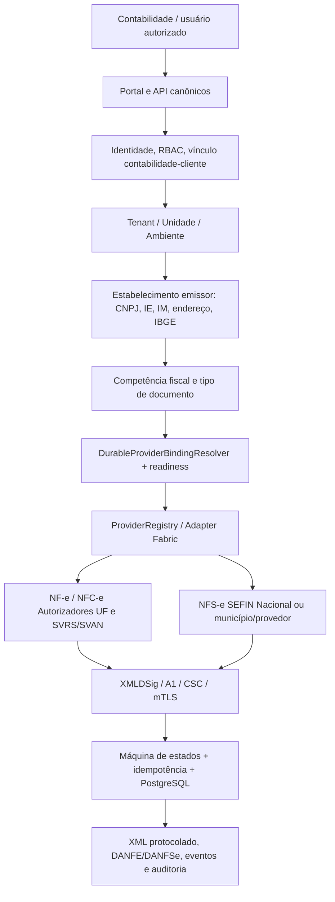

# FM NFCORE V1 — Arquitetura de Expansão Fiscal Nacional (27 UFs)

**Documento:** NFV1-NAT-ARCH-001  
**Data:** 05/11/2026  
**Estado:** PROPOSTA TÉCNICA PARA APROVAÇÃO; **não implementado, não homologado**  
**Repositório:** `faabio3131/nf-core-v001`  
**Linha de arquitetura:** FM NFCORE V1 — Commercial Launch → V1.x, sem fork ou reescrita  
**Escopo:** empresas, escritórios contábeis e filiais com estabelecimentos em todas as UFs brasileiras; NF-e modelo 55, NFC-e modelo 65 e NFS-e, mediante elegibilidade.

## 1. CURRENT verificado (05/11/2026)

- A branch `main` contém `ExecutionScope` com `host_namespace/tenant_id/unit_id/environment`, `FiscalProfile` versionado com CNPJ, IE e IM opcional, `FiscalAddress` com UF/IBGE e `BrazilianJurisdiction` aceitando as UFs brasileiras.
- `control_plane/commercial.py` contém `ProviderBinding` e `DurableProviderBindingResolver` que selecionam provedor por tenant, unidade, ambiente, documento, UF, município e operação. O Control Plane já governa cadastros e vínculos.
- `runtime/canonical_fiscal_composition.py` em `main` possui transporte SEFAZ-SP e operações; NFS-e Nacional, R16 SP, aprimoramentos XML/DANFE e quatro workers estão **em PR #355 (DRAFT), não em main/produção**. Revalidar a PR e os gates antes de reusar qualquer código nela.
- API, Web, PostgreSQL, Vault A1 e deploy Contabo existem, mas não significam homologação nas demais UFs.
- A experiência da contabilidade com acesso a **múltiplos clientes/tenants** requer auditoria específica: `ExecutionScope` por tenant/unidade não concede automaticamente vínculo profissional sobre vários tenants. Não criar identidade ou autorização alternativa.

## 2. Princípio constitucional de arquitetura

**Uma única linha de execução e autoridades:** Cadastro/Identidade → `ExecutionScope` → perfil fiscal versionado → competência e jurisdição → `DurableProviderBindingResolver` → `ProviderGatewayService` + `ProviderRegistry` → adaptador oficial determinado por contrato → assinatura A1/CSC/credenciais segregadas → máquina de estados/idempotência canônica → archive/auditoria → API/Portal existentes.

**Não criar:** segunda API, segunda autenticação, segundo roteador autoritativo, segundo Tax Rule Engine, segundo vault, segunda persistência, frontend paralelo, regra de UF no browser ou um adapter genérico que fabrique autorização.

A seleção de autorizador é determinística e **governada por configuração versionada**, não por `if UF == ...` no fluxo principal. A inclusão de uma **UF em um autorizador já suportado** ocorre por alteração de configuração aprovada sem deploy; novo **protocolo/contrato técnico genuinamente distinto** pode exigir um adaptador reutilizável e nova versão, nunca lógica descartável por cliente.

## 3. Visão lógica

**Duas dimensões diferentes:** domicílio da **contabilidade** não é autoridade para o autorizador; UF do **estabelecimento emissor** e regras de operação/competência determinam o roteamento. Para NFS-e, conferir local de incidência/competência, município competente e regime aplicável antes de selecionar o autorizador; município do prestador e município de tributação nem sempre são iguais.

## 4. Módulos canônicos e evolução necessária

| ID | Módulo | Autoridade a reutilizar | Evolução TARGET |
|---|---|---|---|
| NAT-CORE | Multiempresa, matriz/filiais e escopo | `ExecutionScope`, `FiscalProfile`, Control Plane | Modelar hierarquia matriz-filial, vinculação do CNPJ do estabelecimento e versões; não confundir tenant com filial |
| NAT-ACL | Escritório contábil e clientes | Identidade humana + RBAC + unidades | Concessão/revogação auditada de acesso profissional a múltiplos tenants sem ampliar automaticamente privilégios |
| NAT-REG | Registry de UF/município/competência | `BrazilianJurisdiction`, dados oficiais, `TaxRuleEngine` | Catálogo IBGE oficial versionado, consistência UF↔município, capacidade por documento/operação e vigência |
| NAT-ROUTE | Resolução nacional | `DurableProviderBindingResolver`, `ProviderRegistry` | Resolver autorizador NF-e/NFC-e por UF/modelo/ambiente/capacidade e NFS-e por município/competência/convênio, com fallback proibido sem política |
| NAT-PROTOCOL | Contratos fiscais | Gateway e transportes existentes | Adapters de transporte **por família técnica** SEFAZ própria, SVRS, SVAN, SEFIN Nacional, municipal comprovado; operações authorize/query/cancel/inutilize/status conforme documento |
| NAT-CRYPTO | Segurança emissora | Vault A1 e `SecretResolutionService` | Certificado por CNPJ/escopo; CSC NFC-e por UF/unidade/ambiente/versão; mTLS, XMLDSig, no-secret-logs |
| NAT-TAX | Regras normativas | `TaxRuleEngine`, RTC existente | Regras versionadas, CFOP/CST/CSOSN/IBS/CBS/IS ou ISS segundo norma efetiva; nunca usar prévia não autoritativa |
| NAT-LIFE | Emissão e recuperação | Ciclo canônico + idempotência | Numeração segura, outbox, retry governado e consulta antes de retransmitir quando resultado é incerto |
| NAT-ARCH | Espelho/downloads | Archive e Portal atuais | XML autorizado e PDF fiscal somente após protocolo/artefato verificável, histórico, hash, escopo, preservação de versões |
| NAT-OBS | Operação e certificação | Telemetria, CI, logs e Contabo existentes | SLO por caminho e provedor, tracing, rate-limits, pool DB, testes carga, alertas, rollback e runbooks |

### 4.1 Contrato de roteamento (alvo)

Entrada canônica (não do browser): `host_namespace, tenant_id, unit_id, environment, issuer_cnpj, issuer_uf, issuer_ibge, tax_competence, document_kind, operation, effective_at`. Para NFS-e também `service_tax_incidence_municipality` e versão da política municipal quando aplicável.

Saída: `ProviderResolution(provider_binding_id, provider_id, authorizer_group, service_contract_version, endpoint_config_ref, credential_ref, policy_version, status, effective_at, provenance)`.

**Regras de segurança:** 
- Falta de perfil, divergência CNPJ↔unidade, município IBGE incompatível, ausência de permissão, binding vencido/inativo ou provider sem readiness => **REJEITAR**, não utilizar SP ou emissor nacional por default.
- O `ProviderBinding` atual já cobre chaves fundamentais, mas precisa de avaliação de **versão/aprovação/vigência/proveniência do catálogo de endpoints**. Evoluir a persistência por migrations governadas quando realmente necessário; não substituir o Control Plane.
- Mudanças normativas e de endpoints exigem trilha de aprovação e rollback. Nunca armazenar segredo no catálogo ou na PR.
- NF-e 55 e NFC-e 65 são modelos distintos com regras, eventos, CSC e QR Code distintos. Não anunciar NFC-e pronta pelo fato da NF-e passar.

### 4.2 Escritório contábil multicliente (obrigatório)

Estabelecer relações auditáveis `AccountantOffice ↔ CustomerOrganization ↔ Unit` com consentimento do cliente, prazo/revogação, papéis por operação (visualizar, emitir, baixar, cancelar, alterar certificado), MFA/step-up para ações sensíveis e log de acesso. **TARGET, não CURRENT certificado.** Proibido conceder `platform_admin` ou acesso amplo só porque usuário pertence ao escritório.

### 4.3 Documentos e jornadas obrigatórias

**NF-e 55:** cadastro emissor → preparo e cálculo governados → XML XSD e XMLDSig → mTLS/protocolo autorizador → consulta/reconciliação → arquivo nfeProc → espelho/DANFE → carta de correção/cancelamento/inutilização se cabíveis.

**NFC-e 65:** regras e CSC por UF → QR Code com URLs homologadas → XML e assinatura → autorização → contingência offline **somente se suportada pela UF e certificada** → XML e DANFE NFC-e → evento/consulta/recuperação.

**NFS-e:** perfil de prestador com IM quando aplicável, tomador CPF/CNPJ, código de serviço, local de incidência, descrição, base/valor/ISS, DPS/RPS conforme contrato → XML/XSD/assinatura → SEFIN Nacional ou fornecedor municipal habilitado → consulta, eventos/cancelamento → XML/NFS-e e PDF (DANFSe quando suportado). **ADN é base de compartilhamento, não sinônimo de emissor público nacional.**

Jornada completa por cliente/filial/UF precisa testar troca de unidade com sessão preservada e proibição de acesso cruzado.

## 5. Política de autoridades fiscais e rollout

Fontes oficiais de referência inicial (consultadas 05/11/2026):
- NF-e: https://www.nfe.fazenda.gov.br/portal/webServices.aspx?AspxAutoDetectCookieSupport=1&tipoConteudo=OUC%2FYVNWZfo%3D — inclui grupos autorizadores próprios, SVRS/SVAN e contingência SVC-AN/SVC-RS. **Lista sujeita a alteração**.
- NFS-e: https://www.gov.br/nfse/pt-br/biblioteca/documentacao-tecnica/documentacao-atual — XSD e anexos nacionais atuais, separados da disponibilidade municipal de emissão.
- ADN: https://www.gov.br/nfse/pt-br/municipios/produtos-disponiveis/ambiente-de-dados-nacional-adn — integração de documentos, não habilitação automática.
- MG NF-e: https://portalsped.fazenda.mg.gov.br/spedmg/nfe/webservices/
- MG NFC-e: https://portalsped.fazenda.mg.gov.br/spedmg/nfce/web-services/
- PR NF-e: https://sped.fazenda.pr.gov.br/NFe/Pagina/Servicos-web-services-disponiveis
- PR NFC-e: https://sped.fazenda.pr.gov.br/NFCe/Pagina/Web-Services-NFC-e
- PR credenciamento NFC-e: https://sped.fazenda.pr.gov.br/NFCe/Pagina/Credenciamento-de-emissores
- MT NFC-e: https://www.sefaz.mt.gov.br/portal/nfce/?pg=cGdJbmZvcm1hY2Fv
- MS NF-e: https://www.sefaz.ms.gov.br/documentos-fiscais-eletronicos/nf-e/
- MS NFC-e: https://www.sefaz.ms.gov.br/documentos-fiscais-eletronicos/nfc-e/

**Achados relevantes:** para NF-e 55, o RJ utiliza SVRS segundo o catálogo nacional; MG, PR, MT e MS possuem autorizadores próprios. Para NFC-e, **não copiar automaticamente a mesma seleção NF-e**; verificar a autoridade e serviços específicos do modelo 65 por UF. O catálogo oficial traz PR como autorizador próprio de NFC-e, e requer CSC e credenciamento específico. Para NFS-e, **cada município** continua uma unidade de certificação fiscal, mesmo em UF já atendida para NF-e.

**Níveis independentes de status por UF/documento/operação:**
`NOT_MAPPED → OFFICIAL_CONTRACT_VERIFIED → ADAPTER_IMPLEMENTED → INTERNAL_TESTED → STAGING_VERIFIED → EXTERNAL_HOMOLOGATED → PRODUCTION_APPROVED`. Estados bloqueantes como `REVOKED`, `CONTRACT_CHANGED` e `CREDENTIALS_MISSING` nunca equivalem a disponibilidade.

## 6. Critérios não funcionais e SLOs

- **Segurança:** nunca usar header/URL como autoridade de tenant ou unidade; A1 não exportável pela Web; CSC protegido; segredo não entra em log.
- **Integridade:** idempotência mesmo após timeout e restart; chave de acesso, número, série e protocolo consistentes; XML nfeProc imutável; sem emissão duplicada.
- **Desempenho:** distinguir HTTP local, proxy/TLS e serviços oficiais. Meta de **400 ms** se aplica ao caminho interno síncrono definido (ex. health/readiness e comandos não fiscais), **não** ao tempo de resposta SEFAZ; aferir P50/P95/P99 e vazão com 50/100 concorrentes e DB sob carga. Requisitos de emissão definem SLA assíncrono e timeouts de provedor separados.
- **Disponibilidade:** circuit-breaker, retry com backoff/DLQ apenas onde seguro, reconciliação de resultados ambíguos, health/readiness por provedor e observabilidade.
- **Operação:** Contabo é infraestrutura oficial atual; sem Railway; deploy apenas com autorização específica, backup verificado, rollout/rollback e smoke test.
- **Certificação por UF:** tests unit/integration/PostgreSQL/XSD/XMLDSig/RBAC/tenant/CSRF/worker/Docker/CI/E2E + homologação oficial com contribuinte elegível antes de declarar disponível.

## 7. Gate de arquitetura e dependências

**NAT-00** exige fechar ou reconciliar a PR #355 e seu impacto sobre rotas fiscais, XML/DANFE e portal, sem iniciar duas composições concorrentes.  
**NAT-01** congela contratos de routing/approval, capacidade e evidência por UF, observando os arquivos canônicos atuais.  
**NAT-02** fecha multiunidade e a representação do vínculo contabilidade-cliente; não duplicar identidades.  
**NAT-03** permite começar MG de maneira isolada com testes e falso provedor local, sem credencial real.  

**Go/No-Go:** apenas o Diretor libera credenciais, emissão fiscal oficial, deploy, migrations produtivas, promoção para `production`, DNS e monetização; documentação ou teste sintético não substitui homologação.

## 8. Decisões propostas e decisões ainda não aprovadas

**Proposta:** priorização MG → RJ → PR → MT → MS; expansão por **módulo completo de UF**, em seguida demais 21 UFs; reuso de infraestrutura; cadastro nacional e provider registry governados.

**Dependem de validação:** contratos de representação contábil, política de vigência/assinatura da configuração, primeiros municípios NFS-e por UF, CSC por UF, modelos suportados por estado e definição operacional de SLO/infra. As datas e esforços são projeções, não compromissos ou certificações.

**Nenhum serviço de UF é declarado homologado nesta proposta.**
